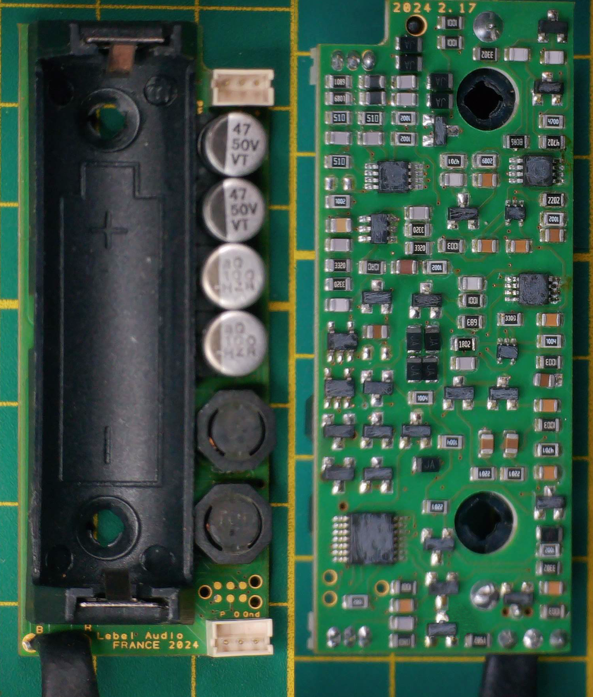

# PWL — alimentation fantôme 48 V sur batterie, MSP430G2252

Firmware d'une alimentation fantôme pour préampli audio alimenté sur batterie.
Élévation vers 48 V par DC/DC polyphasé, sur un microcontrôleur à 20 broches
et 512 octets de RAM.

Porté depuis sur MSPM0 → [**CCS-MSPM0-pwl**](https://github.com/Nicolboy/CCS-MSPM0-pwl).

  

---

## Ce que fait le firmware

| | |
|---|---|
| **DC/DC polyphasé** | deux oscillateurs déphasés de 180°, sur `TA0.1` et `TA1.1` |
| **Soft start** | montée progressive du 48 V au démarrage |
| **Surveillance** | ADC10 sur trois voies — 48 V, batterie, Vcc — déclenché par `TA0.0` toutes les 1,5 s |
| **Auto-étalonnage** | écrit en **flash** : au démarrage, si la flash est vierge le firmware se calibre seul sous charge de 10 kΩ, sinon il restaure ses paramètres |
| **Protection batterie** | trois seuils — clignotement rouge, clignotement rapide, puis arrêt de l'audio, arrêt du 48 V et veille profonde |

L'auto-étalonnage est la partie intéressante : plutôt que de figer un rapport
cyclique calculé, le firmware ajuste le timer PWM jusqu'à lire entre 43 et 44 V
sur une charge connue, puis sauve la valeur. Chaque carte se règle donc sur ses
propres composants — ce qui dispense de trier les inductances.

---

## État

En production. La dernière modification, mars 2026, est un recalage du seuil
`VPH` — 560 → 680 — après mesure sur carte.

Les constantes de seuil sont des **valeurs mesurées**, pas calculées. Le
commentaire qui accompagne chacune dit sur quoi elle est fondée.

---

## Compiler

Projet Code Composer Studio pour **MSP430G2252**.

- `msp430g2xx2_1.c` — tout le firmware, journal de version compris
- `lnk_msp430g2252.cmd` — script d'édition de liens, fourni par TI

Le nom du fichier source vient de l'exemple TI dont le projet est parti en
2019 ; il n'en reste rien. Le script d'édition de liens, lui, est bien celui de
TI et **garde son en-tête de copyright** — condition de sa licence BSD.

---

## Historique

Le projet remonte à 2018 et a traversé plusieurs cartes :

- auto-étalonnage introduit en 2019
- version sans auto-étalonnage mais avec référence de tension, 2020
- retour vers un G2452 à 14 broches, sans oscillateurs polyphasés
- basculement d'oscillateur piloté directement par le µC, 2022
- versions 2.11 à 2.17 sur G2252

Seule la dernière est publiée. Le journal complet est en tête du source.

---

## Licence

[MIT](LICENSE).

Exception : `lnk_msp430g2252.cmd` reste sous licence **Texas Instruments**,
BSD à trois clauses, avec son en-tête d'origine.
